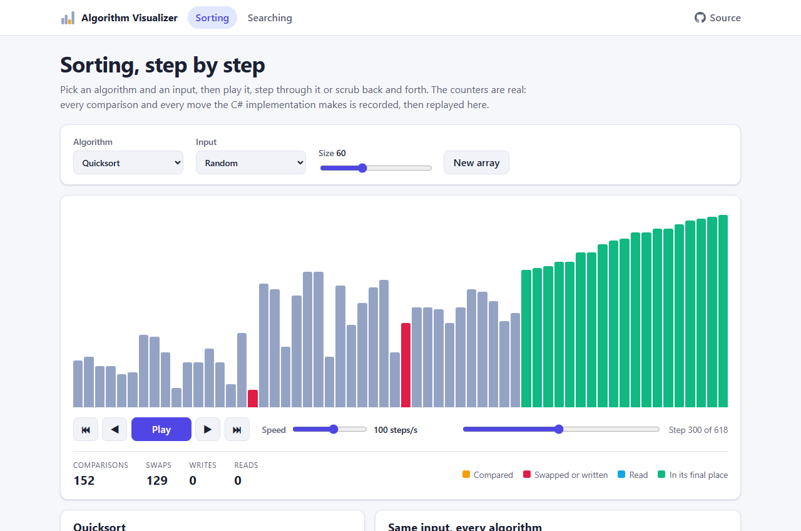
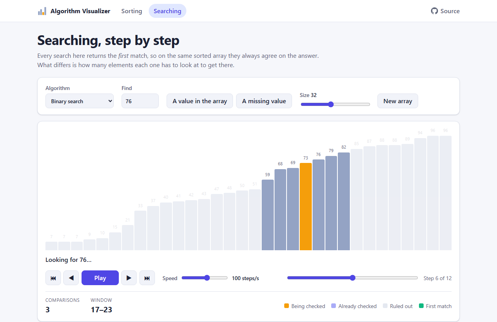
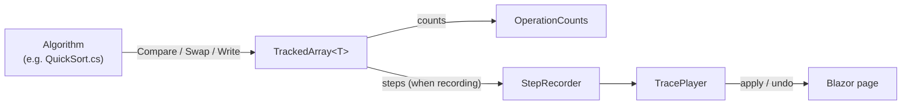

# Algorithm Visualizer

[](https://github.com/Armin0001/algorithm-visualizer/actions/workflows/ci.yml)
[](https://armin0001.github.io/algorithm-visualizer/)
[](https://dotnet.microsoft.com/)
[](LICENSE)

Nine sorting algorithms and three searches, written in C# and replayed step by step in your browser.
Every bar that moves is a step the real implementation took, and the comparison and swap counters are the real counts.

**Live demo: [armin0001.github.io/algorithm-visualizer](https://armin0001.github.io/algorithm-visualizer/)**



## The problem

Most algorithm visualizers animate a separate, simplified copy of each algorithm, written for the animation.
What you watch isn't the code that was tested, and the "comparisons" counter is whatever the animation decided to count.

## Why it matters

If the animation and the implementation can drift apart, the visualization can quietly teach the wrong thing,
for example a quicksort that looks fast on sorted input when the real one isn't.
Here each algorithm is written once, and that same code:

- runs silently in the unit tests, which check its output, stability and operation counts, and
- records every comparison, swap and write as a step that the browser replays.

The animation can't drift from the implementation, and the numbers on screen are the numbers the tests check.

## What's in it

| Algorithm | Best | Average | Worst | Extra space | Stable | |
|---|---|---|---|---|---|---|
| Bubble sort | O(n) | O(n²) | O(n²) | O(1) | yes | [watch](https://armin0001.github.io/algorithm-visualizer/?algorithm=bubble-sort) · [code](src/AlgorithmVisualizer.Core/Sorting/BubbleSort.cs) |
| Selection sort | O(n²) | O(n²) | O(n²) | O(1) | no | [watch](https://armin0001.github.io/algorithm-visualizer/?algorithm=selection-sort) · [code](src/AlgorithmVisualizer.Core/Sorting/SelectionSort.cs) |
| Insertion sort | O(n) | O(n²) | O(n²) | O(1) | yes | [watch](https://armin0001.github.io/algorithm-visualizer/?algorithm=insertion-sort) · [code](src/AlgorithmVisualizer.Core/Sorting/InsertionSort.cs) |
| Shell sort (Knuth gaps) | O(n log n) | ≈ O(n^1.25) | O(n^1.5) | O(1) | no | [watch](https://armin0001.github.io/algorithm-visualizer/?algorithm=shell-sort) · [code](src/AlgorithmVisualizer.Core/Sorting/ShellSort.cs) |
| Merge sort | O(n) | O(n log n) | O(n log n) | O(n) | yes | [watch](https://armin0001.github.io/algorithm-visualizer/?algorithm=merge-sort) · [code](src/AlgorithmVisualizer.Core/Sorting/MergeSort.cs) |
| Quicksort (three-way) | O(n) | O(n log n) | O(n²) | O(log n) | no | [watch](https://armin0001.github.io/algorithm-visualizer/?algorithm=quick-sort) · [code](src/AlgorithmVisualizer.Core/Sorting/QuickSort.cs) |
| Heap sort | O(n log n) | O(n log n) | O(n log n) | O(1) | no | [watch](https://armin0001.github.io/algorithm-visualizer/?algorithm=heap-sort) · [code](src/AlgorithmVisualizer.Core/Sorting/HeapSort.cs) |
| Counting sort | O(n + k) | O(n + k) | O(n + k) | O(n + k) | yes | [watch](https://armin0001.github.io/algorithm-visualizer/?algorithm=counting-sort) · [code](src/AlgorithmVisualizer.Core/Sorting/CountingSort.cs) |
| Radix sort (LSD) | O(d·(n + b)) | O(d·(n + b)) | O(d·(n + b)) | O(n + b) | yes | [watch](https://armin0001.github.io/algorithm-visualizer/?algorithm=radix-sort) · [code](src/AlgorithmVisualizer.Core/Sorting/RadixSort.cs) |
| Linear search | O(1) | O(n) | O(n) | O(1) | | [watch](https://armin0001.github.io/algorithm-visualizer/search?algorithm=linear-search) · [code](src/AlgorithmVisualizer.Core/Searching/LinearSearch.cs) |
| Binary search | O(log n) | O(log n) | O(log n) | O(1) | | [watch](https://armin0001.github.io/algorithm-visualizer/search?algorithm=binary-search) · [code](src/AlgorithmVisualizer.Core/Searching/BinarySearch.cs) |
| Jump search | O(1) | O(√n) | O(√n) | O(1) | | [watch](https://armin0001.github.io/algorithm-visualizer/search?algorithm=jump-search) · [code](src/AlgorithmVisualizer.Core/Searching/JumpSearch.cs) |

Five input shapes (random, nearly sorted, reversed, few unique values, already sorted) show where each algorithm shines or struggles,
and a table runs every algorithm on the same input so you can compare the work they do.
Links can set the starting state, for example [`?algorithm=heap-sort&input=reversed&size=60`](https://armin0001.github.io/algorithm-visualizer/?algorithm=heap-sort&input=reversed&size=60).



## How it works



- **[`TrackedArray<T>`](src/AlgorithmVisualizer.Core/TrackedArray.cs)**: every algorithm works through this wrapper and never touches the array directly.
  It counts each operation and, when a recorder is attached, records it as a [`Step<T>`](src/AlgorithmVisualizer.Core/Tracing/Step.cs).
- **[`TracePlayer<T>`](src/AlgorithmVisualizer.Core/Playback/TracePlayer.cs)**: replays a recorded run. Every step can be undone
  (a swap swaps back, a write keeps the value it overwrote), so stepping backwards and scrubbing never re-run the algorithm.
- **[`AlgorithmCatalog`](src/AlgorithmVisualizer.Core/AlgorithmCatalog.cs)**: the single list of algorithms. The UI reads it, and so do the tests,
  so a new algorithm is tested the moment it's listed.
- **[Blazor WebAssembly UI](src/AlgorithmVisualizer.Web)**: the C# runs in the browser, so there's no server. It's hosted as static files on GitHub Pages.

## Key decisions and tradeoffs

- **Record the whole run, then replay it.** Play, pause, step back and scrub become cheap state changes, and the algorithms stay ordinary
  loops and recursion with no `async` or `yield` plumbing. The tradeoff is memory: one small struct per operation
  (about 1,250 steps for bubble sort on 40 random values), which is why the UI caps arrays at 150 elements.
- **Generic algorithms with an `IComparer<T>`.** The sorts work on any `T`, not just `int`. That's what lets the
  [stability tests](tests/AlgorithmVisualizer.Core.Tests/StabilityTests.cs) sort cards by rank and check that equal ranks keep their deal order.
  Counting and radix sort never compare items, so they take an integer key selector instead.
- **Quicksort: three-way partitioning, median of three sampled at the quartiles.** Three-way (Dijkstra) partitioning turns many repeated keys
  into a best case instead of a worst case: an all-equal array takes a single pass. The first version used the textbook median of the first,
  middle and last elements, and the [complexity tests](tests/AlgorithmVisualizer.Core.Tests/ComplexityTests.cs) caught it going quadratic:
  4n log₂n comparisons on sorted input at n = 4,096, and still climbing as n grew. The partition leaves each side rotated by one, with its
  smallest value at the end, so an end sample is nearly always an extreme. Sampling at the quartiles brought sorted input down to about 0.95n log₂n.
- **Binary search returns the first match.** It's the lower-bound variant, so with duplicates it agrees with linear search and `Array.IndexOf`.
  The cost is no early exit on a hit, so its best case is O(log n) rather than O(1).
- **Merge sort copies only the left half.** The right run merges in place, so the buffer is n/2. A check that skips merging halves
  already in order makes sorted input a single O(n) pass.
- **Counting sort caps its key range** at about a million counters and points you to radix sort beyond that, instead of trying to allocate
  four billion counters for `int.MinValue..int.MaxValue`.
- **Invariant globalization in the web app.** The UI has no locale-specific text, so dropping the ICU data makes the download smaller
  and numbers format the same in every browser.

## Tests

149 tests, written with xUnit v3 on Microsoft.Testing.Platform. Most are theories that run against every algorithm in the catalog.

- **Correctness**: sorts match `Array.Sort` on random arrays of 2 to 1,000 elements, on every input shape, and on negatives and `int.MinValue`/`int.MaxValue`.
  Searches match `Array.IndexOf`, duplicates included.
- **Stability, in both directions**: stable sorts never reorder equal keys, and every sort labelled unstable must be caught doing it,
  so the label in the UI can't be wrong either way.
- **In place, also in both directions**: sorts labelled in place allocate under 1 KB of heap while sorting 8,192 ints, and the ones
  labelled as using extra memory must be caught allocating at least a half-size buffer.
- **Complexity, as numbers**: exact counts where theory gives one (selection sort makes exactly n(n−1)/2 comparisons; bubble and insertion sort
  swap exactly once per inversion; binary search stays within ⌊log₂n⌋ + 2 comparisons), and comparison budgets for the n log n sorts on six
  input shapes, including the ones that broke the first quicksort.
- **Replay**: replaying any recorded run reproduces the algorithm's output and counts exactly, and stepping all the way back restores the input.

Line coverage of the core library is about 98% (95% of branches). CI publishes the coverage report with every run.

## CI/CD

[`.github/workflows/ci.yml`](.github/workflows/ci.yml) runs on every push and pull request:
it builds with warnings treated as errors, runs the tests with coverage (the summary appears on the run's page) and publishes the Blazor app.
Pushes to `main` then deploy it to GitHub Pages, so the live demo always matches `main`.

## Run it locally

You need the [.NET 10 SDK](https://dotnet.microsoft.com/download/dotnet/10.0).

```bash
git clone https://github.com/Armin0001/algorithm-visualizer.git
cd algorithm-visualizer
dotnet test                                        # run all the tests
dotnet run --project src/AlgorithmVisualizer.Web   # then open the URL it prints
```

For a coverage report: `dotnet test --coverage --coverage-output-format cobertura`.

```
src/AlgorithmVisualizer.Core          algorithms, TrackedArray, recording and replay (no UI dependencies)
src/AlgorithmVisualizer.Web           Blazor WebAssembly app
tests/AlgorithmVisualizer.Core.Tests  xUnit v3 tests
```

## What's next

- A race mode: two algorithms side by side on the same input, on one clock.
- Keep the URL in sync while you click around, so any moment can be shared.
- Introsort (quicksort that falls back to heap sort when it goes too deep), which would make the O(n²) worst case impossible.

## License

[MIT](LICENSE)
